# GAAN: Free, Open-Source Spotify Alternative with AI Recommendations for Windows & macOS

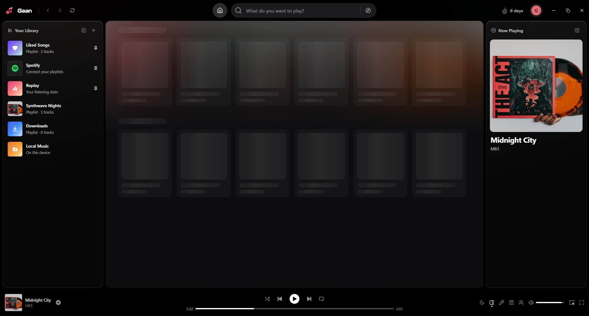

**GAAN is a free, open-source music player for Windows and macOS: the YouTube Music catalog and your own local files in one app, with no ads, no subscription, word-synced lyrics, aesthetic themes, and AI-powered recommendations.** Bring your Spotify playlists over, listen together with friends in Rooms, customize your look with designer themes, and enjoy AI smart shuffle powered by Gemini, Groq, Cohere, and OpenAI.

**[Download](#installation)** · **[Website](https://gaan.space/)** · **[Releases](https://github.com/rumman2004/Gaan-Desktop/releases)** · **[Contributing](CONTRIBUTING.md)** · **[License](#license)**

[](https://github.com/rumman2004/Gaan-Desktop/releases/latest)
[](https://github.com/rumman2004/Gaan-Desktop/releases)
[](https://github.com/rumman2004/Gaan-Desktop/stargazers)
[](LICENSE)
[](#installation)

---

## What is GAAN?

GAAN is a modern desktop music player for Windows and macOS, built with Electron, React and TypeScript. It streams YouTube Music's public catalog without requiring a Google sign-in, plays your local files (MP3, M4A/AAC, FLAC, WAV, OGG, Opus) side by side in the same library, and delivers a true desktop experience: one unified queue, word-synced lyrics, playlist management, mini player (PiP), listening stats, and keyboard shortcuts.

### Highlights

- **AI-Enhanced Queue & Smart Shuffle** — Multi-tier auto-cascade intelligence powered by Google Gemini, Groq (ultra-fast LPU), Cohere, and OpenAI/xingchiapi. Seamlessly reorders upcoming queue tracks into harmonic vibe flow and surfaces fresh discoveries.
- **Playlist AI Recommendations** — Inside any playlist, GAAN analyzes track vibes and curates 5 tailor-made song recommendations with instant one-click additions and infinite shuffle refresh.
- **Aesthetic Designer Themes** — Choose between **System**, **Dark**, **Light**, 🌿 **Olive Green & Beige Cream** (`#4D694E` & `#FFF3D5`), and 💖 **Rose Velvet / Pookie** (Grapefruit `#DA6C81`, Vanilla `#F5E9D0`, Raspberry `#BF2B54`).
- **YouTube Music on the desktop** — Explore moods, genres, podcasts, and search across songs, videos, albums, artists, and playlists without account requirements.
- **Word-synced lyrics** — Real-time line and word highlighting in sync with your music; pulls from 13 sources including LRCLIB and Musixmatch with per-track timing offsets.
- **Rooms (Listen Together)** — Sync playback with up to 10 friends in real-time, hearing the exact same song at the same second.
- **Spotify playlist import** — Paste any public Spotify playlist link or text list, and GAAN maps every track to YouTube Music automatically.
- **Endless AutoPlay** — Keeps music playing smoothly with context-aware recommendations when your queue finishes.
- **Fullscreen Now Playing** — Immersive artwork, live audio visualizer, dynamic cover glow, and synchronized lyrics.
- **Mini Player (Picture-in-Picture)** — Compact always-on-top window with hover controls that folds into an ultra-slim desktop bar.
- **Local music library** — Point to your music folders to index albums and artists with automatic non-music filtering (voice notes, short clips).
- **Offline downloads** — Save tracks locally with selectable audio quality and real-time download progress.
- **Replay listening stats** — Track your top artists, songs, minutes, and streaks by week, month, year, or all-time, with 1080×1920 story card exports.
- **In-App Auto-Updates** — Checks GitHub Releases API for newer semantic versions and release timestamps with one-click download & restart on Windows.

---

## Screenshots

### Main Player & Home


### AI Playlist Recommendations & Shuffle
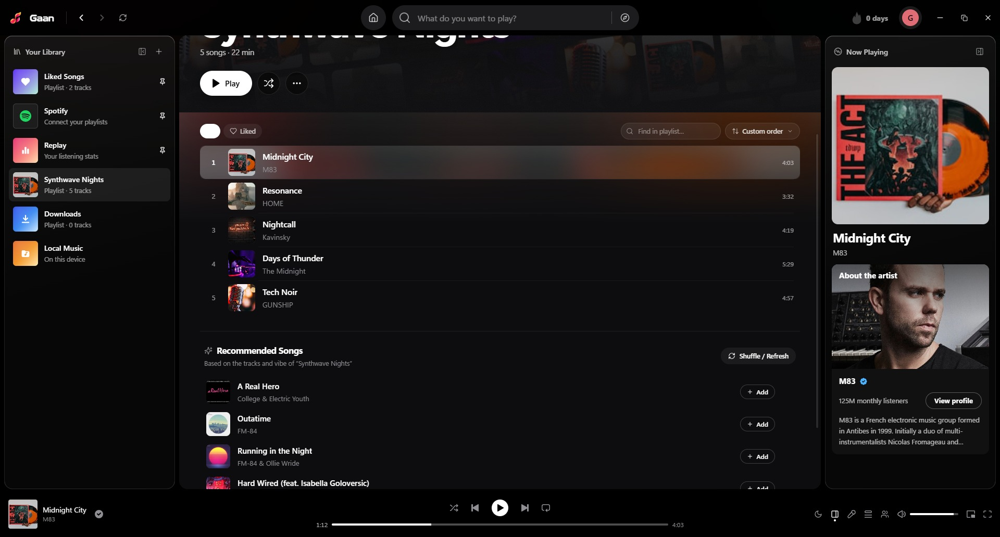
*Inside any playlist, GAAN curates 5 fresh AI recommendations matched to your playlist's genre and vibe, with one-click additions and instant shuffle.*

### Aesthetic Themes

<table>
  <tr>
    <td align="center"><b>🌿 Olive Green & Beige Cream</b></td>
    <td align="center"><b>💖 Rose Velvet (Pookie)</b></td>
  </tr>
  <tr>
    <td>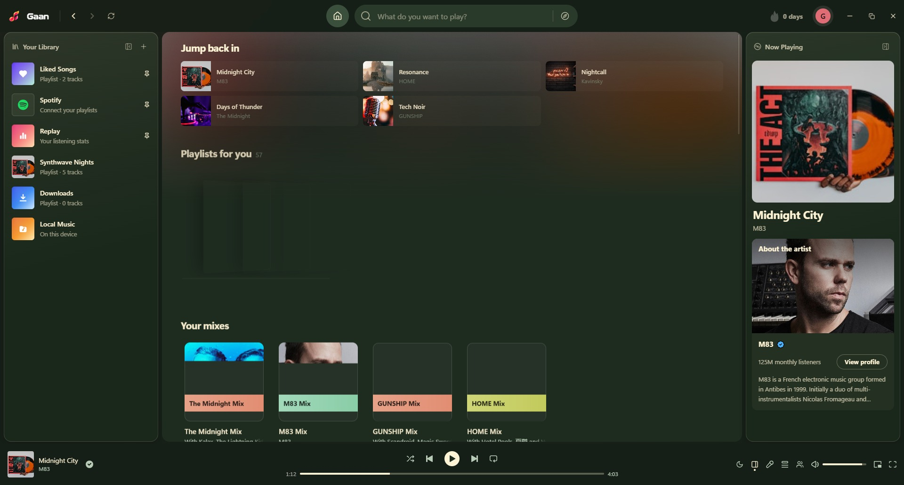</td>
    <td>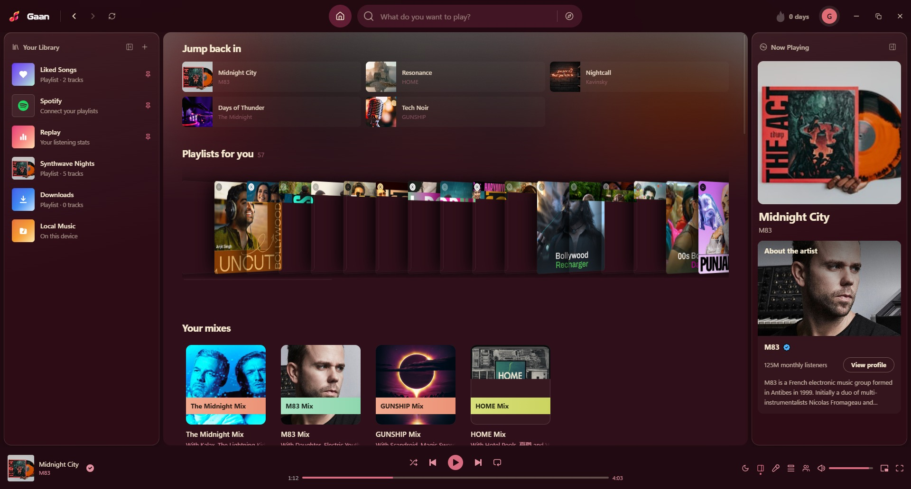</td>
  </tr>
</table>

### Settings & AI Provider Cascade
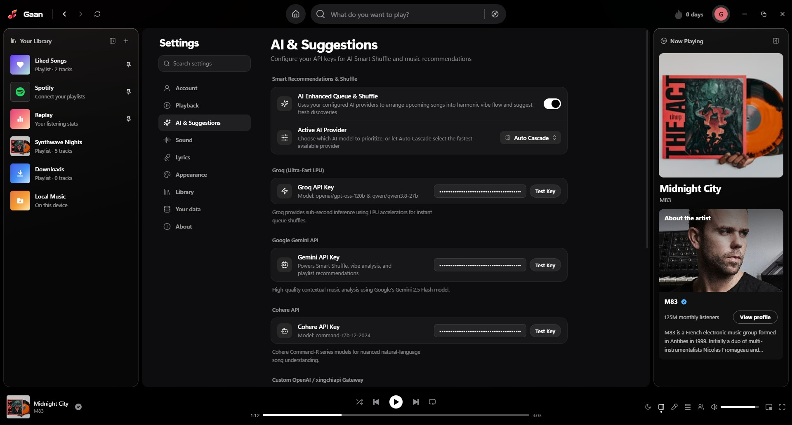
*Configure your AI providers (Groq LPU, Gemini Flash, Cohere Command-R, Custom OpenAI / xingchiapi gateway) or let Auto Cascade pick the fastest available model.*

### Appearance & Theme Customizer
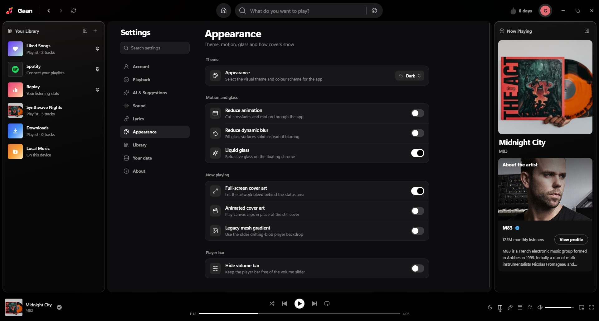

### Fullscreen Cinematic View
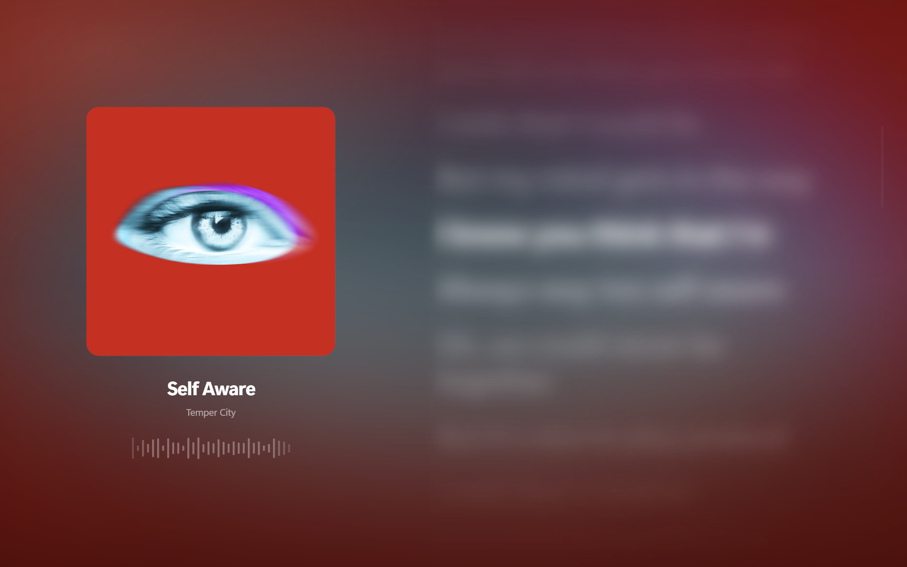

### Synchronized Lyrics
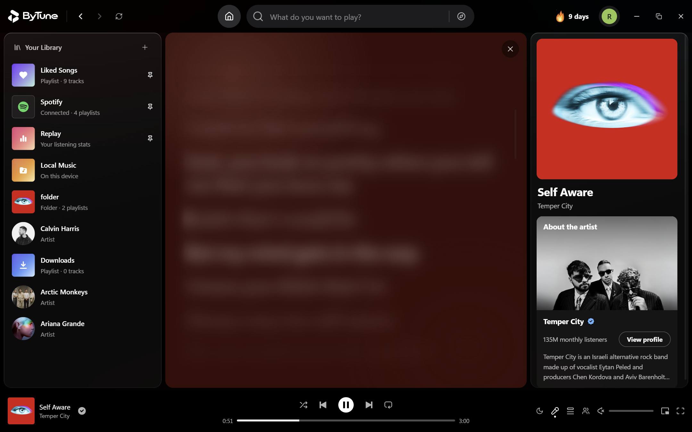

### Artist & Album Pages
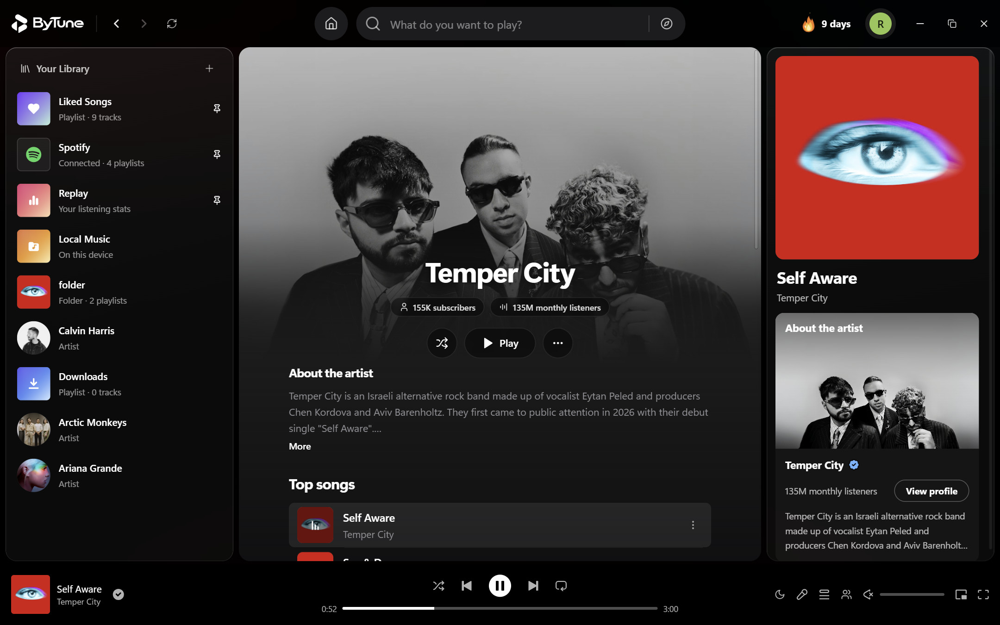

### Mini Player (Picture-in-Picture)
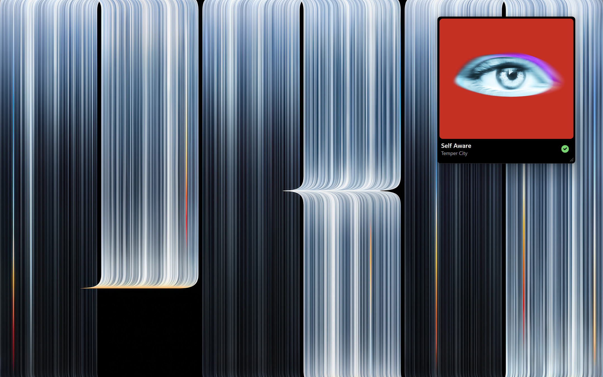

### Queue & Now Playing
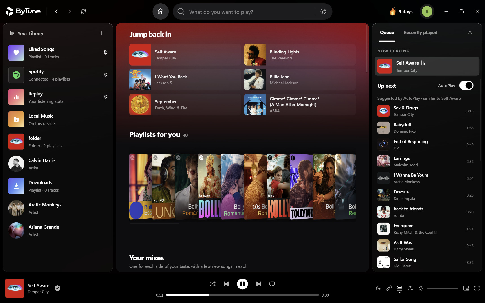

### Replay Listening Stats
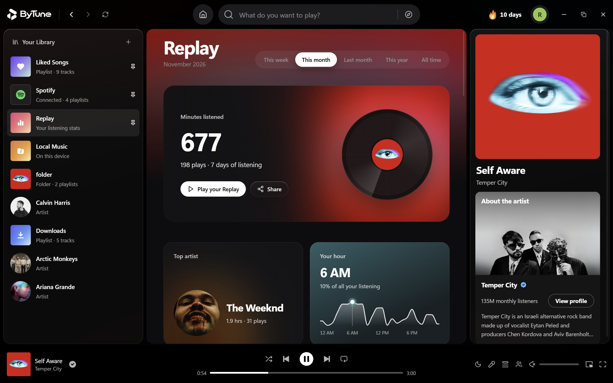
<p align="center">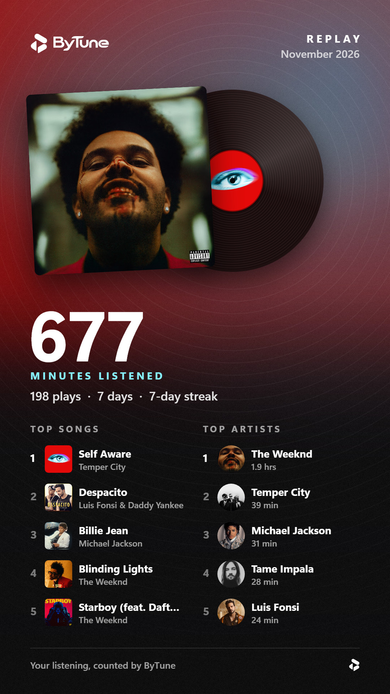</p>

---

## Feature Overview

| Feature | GAAN |
|---|---|
| Free: no ads, no subscription, no paid tier | ✅ |
| Open source (GPL-3.0) | ✅ |
| Streaming from YouTube Music (no Google account needed) | ✅ |
| AI Smart Recommendations & Harmonic Queue Shuffle | ✅ |
| Multi-Provider AI Cascade (Gemini, Groq, Cohere, OpenAI Gateway) | ✅ |
| Playlist AI Recommendations (5 tracks + instant shuffle) | ✅ |
| Themes: System, Dark, Light, Olive & Cream, Rose Velvet | ✅ |
| Word- or line-synced lyrics from 13 sources with click-to-seek | ✅ |
| Rooms: listen together with up to 10 friends | ✅ (free account) |
| Spotify playlist import (public URL or song list) | ✅ |
| Fullscreen Now Playing view with live visualizer | ✅ |
| Mini player (Picture-in-Picture) with folding bar | ✅ |
| Queue with drag reorder, play next, and endless AutoPlay | ✅ |
| Local music library (MP3, M4A/AAC, FLAC, WAV, OGG, Opus) | ✅ |
| Downloads for offline listening | ✅ |
| Listening statistics & shareable story cards (Replay) | ✅ |
| 10-band equalizer, volume leveling, output device picker | ✅ |
| Crossfade up to 12s, Automix, skip silence, pitch-preserving speed | ✅ |
| In-App Auto-Updates (Version & Release Timing validation) | ✅ |
| Windows media keys, SMTC overlay, close to tray | ✅ Windows |
| Native macOS traffic lights, menu bar, close-to-hide | ✅ macOS |

---

## Installation

### Download

**Windows 10/11 (64-bit)**:
- **[Download Gaan-Setup.exe](https://github.com/rumman2004/Gaan-Desktop/releases/latest/download/Gaan-Setup.exe)** *(always points to the newest release)*
- Run the installer (`Gaan-Setup.exe`). If Windows SmartScreen displays a notice on first run, click **More info** → **Run anyway**.

**macOS (Apple Silicon & Intel)**:
- Grab the latest DMG from the **[Releases Page](https://github.com/rumman2004/Gaan-Desktop/releases)** (`-arm64` for Apple Silicon M1+, `-x64` for Intel).
- Drag **GAAN** into your **Applications** folder.

---

## Development

### Prerequisites
- Node.js 20+ (Node 22 recommended)
- npm

### Quick Start
```bash
# Clone the repository
git clone https://github.com/rumman2004/Gaan-Desktop.git
cd Gaan-Desktop

# Install dependencies
npm install

# Start Vite renderer + Electron main with hot reload
npm run dev
```

### Useful Commands
```bash
npm run typecheck    # TypeScript verification
npm test             # Run test suite
npm run build        # Build renderer + Electron main
npm run dist:win     # Package Windows NSIS installer (.exe) into release/
npm run dist:mac     # Package macOS DMG/ZIP into release/
```

### GitHub Actions CI/CD Secrets
To build and publish releases via GitHub Actions, add these repository secrets under **Settings → Secrets and variables → Actions**:

- `GAAN_SUPABASE_URL` — Supabase backend endpoint
- `GAAN_SUPABASE_KEY` — Supabase public client key
- `GEMINI_API_KEY` — Google Gemini recommendation API
- `GROQ_API_KEY` — Groq ultra-fast LPU inference API
- `COHERE_API_KEY` — Cohere Command models API
- `OPENAI_API_KEY` — OpenAI / custom gateway bearer token
- `OPENAI_BASE_URL` — Gateway URL (e.g. `https://api.xingchiapi.com/v1`)
- `OPENAI_MODEL` — Model name (e.g. `gpt-6.1-sol`)

---

## Architecture

```
UI (React 18 + Tailwind CSS + Lucide Icons)
        │
Application State (Zustand: player · library · settings · ui)
        │
Audio Engine & Player Bar (Web Audio API, MediaSession, shortcuts)
        │  IPC (contextBridge preload)
Electron Main Process
  ├─ music-service     YouTube Music catalog & lyrics
  ├─ stream-proxy      Local range-aware media proxy
  ├─ downloads         Track downloader with progress events
  ├─ updater           Version & release timing checker (GitHub API + electron-updater)
  ├─ pip               Mini player window (always-on-top, state-synced)
  ├─ mac-menu          Native macOS application menu bar
  ├─ supabase          Auth (guest / cloud) + library sync & Rooms
  └─ persist           JSON storage for library, settings & history
```

---

## License

Copyright © 2026. GAAN is licensed under the **GNU General Public License v3.0** (see [LICENSE](LICENSE)). Third-party packages and their respective licenses are listed in [NOTICE](NOTICE).

Official downloads and source code are available at:
**[https://github.com/rumman2004/Gaan-Desktop](https://github.com/rumman2004/Gaan-Desktop)**
